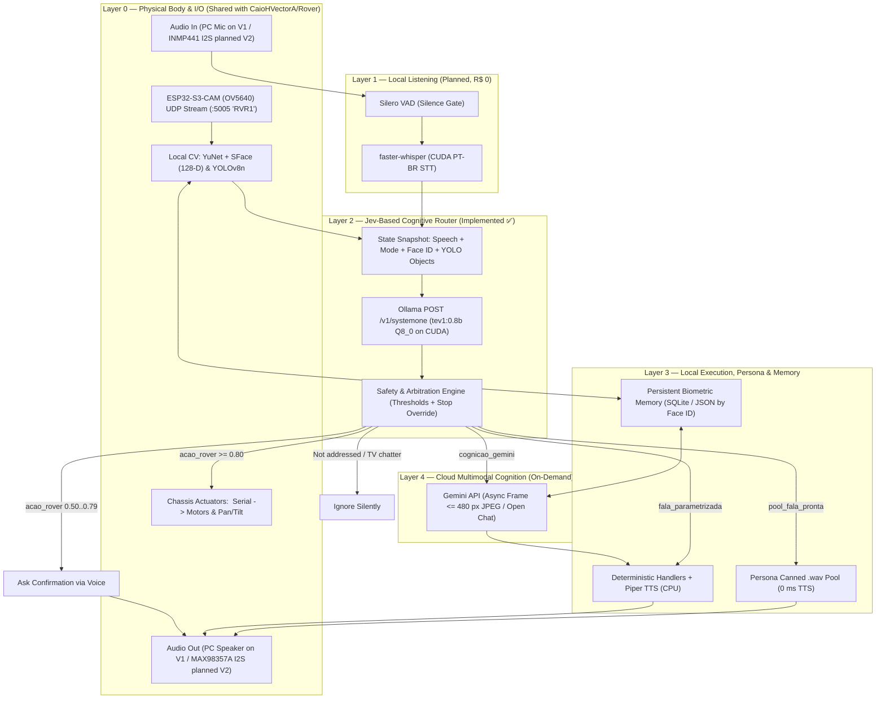

# 🤖 PETeleco — Cognitive Robotics, Persona & Layered AI Pipeline

🇺🇸 **English** | [🇧🇷 Leia em Português (BR)](README.pt-BR.md)

**PETeleco** is the cognitive AI, persona, and communication-protocol repository developed at **PET Elétrica UFF** ([`PetEletricaUFF`](https://github.com/PetEletricaUFF)). It implements an expressive, persona-driven embodied agent ("simulated sentience" — academically framed as **Cognitive Robotics / Embodied AI / Human-Robot Interaction**) capable of listening, speaking naturally in Brazilian Portuguese, recognizing people, maintaining face-indexed conversational memory, describing scenes, and safely commanding a physical mobile robot.

---

## 🔗 Inspiration & Parallel Development with `CaioHVectorA/Rover`

PETeleco is directly inspired by and developed in parallel with **[`CaioHVectorA/Rover`](https://github.com/CaioHVectorA/rover)**:

| Repository | Role in the Shared Research System | Scope |
|---|---|---|
| **[`CaioHVectorA/Rover`](https://github.com/CaioHVectorA/rover)** | **Physical Body & Low-Level Vision** | 4WD ABS chassis, KiCad PCB, `ESP32-S3-CAM` (`OV5640`), chassis MCU (`Nano V3` → `ESP32 DevKit`), UDP video stream, serial `<C,a,b,c>` actuation, and standalone CV modules (`YuNet + SFace`, `YOLOv8n`, `MediaPipe`). |
| **`PetEletricaUFF/PETeleco`** *(this repo)* | **Cognitive Brain, Persona & Protocols** | Layered local-first AI architecture, Jev-based probabilistic intent routing, speech pipeline (VAD/STT/TTS), persistent social memory per face, persona response policies, and motor safety gating. |

Both repositories share the **same physical robot hardware and host inference machine**, allowing mechatronics/firmware work and cognitive AI experiments to evolve cleanly without coupling CAD/firmware clutter into the AI codebase.

---

## 💡 Core Concept: Cost- & Latency-Aware Embodied Persona

Sending every detected phrase and camera frame directly to a cloud LLM/VLM makes a physical robot slow, expensive, and unsafe around motors (plus noisy when reacting to background chatter or TV audio).

PETeleco solves this with a **5-layer hierarchical pipeline**:
1. **Local-first triage (R$ 0 / low latency):** A tiny local SystemOne router evaluates ambient speech + live sensor state in **~353 ms** (`p50`) before deciding whether the robot was even addressed.
2. **Persona immediacy (`0 ms` TTS):** Greetings, farewells, confirmations, and praise trigger pre-recorded persona `.wav` clips instead of waiting on neural speech synthesis or cloud APIs.
3. **Deterministic skills + Local TTS:** Time, weather, battery/temperature telemetry, and active face identity query local deterministic handlers and speak via local CPU **`Piper TTS`**.
4. **Probabilistic motor safety interlocks:** Physical movement commands require high calibrated confidence (`>= 0.80` direct execution; `0.50–0.79` confirmation prompt; explicit emergency stop `>= 0.90` immediate cut).
5. **Cloud escalation strictly on demand:** Multimodal cloud cognition (`Gemini`) is invoked only when a visual scene description or open-ended conceptual answer is genuinely needed.

---

## 🏗️ Layered Architecture



---

## 🧠 Models & Hardware Budget

Designed to keep **all active local models resident inside 8 GB VRAM** (host target: **NVIDIA GeForce RTX 3050 OEM 8 GB** + Intel Core i5-14600 + 16 GB DDR5):

| Layer | Component / Model | Role | Host / Runtime | Status |
|---|---|---|---|---|
| **L1 (Audio)** | `Silero VAD` | Cuts silence before STT runs | CPU / Local Python | Planned |
| **L1 (Audio)** | `faster-whisper` (`base` / `small`) | Continuous PT-BR speech-to-text | GPU CUDA (`~0.5–1.0 GB` VRAM) | Planned |
| **L2 (Router)** | **`tev1:0.8b`** (`772.85M`, `Q8_0`, `qwen35`) | Parallel `noul`/`choice` routing via `/v1/systemone` | Ollama CUDA (`1245.7 MiB` VRAM) | **✅ Implemented & Benchmarked** |
| **L3 (Speech)** | `Piper TTS` + Persona `.wav` pool | Expressive local PT-BR voice synthesis | CPU (`~0 GB` VRAM) | Planned |
| **L3 (Vision)** | `YuNet` + `SFace` (ONNX, `128-D`) | Face detection & biometric identification (`cosine >= 0.363`) | Local OpenCV ONNX | Validated in `Rover` |
| **L3 (Vision)** | `YOLOv8n` + `MediaPipe Hands` | Object detection, trekking FSM & gestures | Local Python / ONNX | Validated in `Rover` |
| **L3 (Memory)** | `SQLite` / `JSON` Memory Store | Stores conversation summaries per recognized face | Local Disk | Planned |
| **L4 (Cloud)** | `Gemini` (`gemini-3.5-flash` baseline) | Open conceptual reasoning & camera `Image-to-Text` | Async HTTPS REST API | Async client validated in `Rover` |

---

## 🔌 Protocols Summary

- **Layer 2 Inference Protocol (`POST /v1/systemone`):** Structured textual `state` + 7 parallel typed questions (`dirigido_ao_robo`, `rota_principal`, `pool_fala_pronta`, `fala_parametrizada`, `acao_rover`, `cognicao_gemini`, `precisa_imagem_camera`) returning calibrated probabilities in a single forward pass.
- **Zero-Delay UDP Video & Discovery (`Port 5005`, from `Rover`):** Custom `'RVR1'` (`0x52565231`) 16-byte `<IHHHHI` packet header, `HELLO` broadcast discovery, RTT ping (`P` + `<d`), and latest-frame socket draining without frame queue buildup.
- **ASCII Chassis Control Frames (`<C,a,b,c>`, from `Rover`):** Compact serial protocol for differential motors (`<M,esq,dir>`), microsecond-smoothed Pan/Tilt (`<S,pan10,tilt10,vel10>`), battery telemetry (`<B,mV,minmV>`), and emergency brake (`<X>`).

See [`docs/ARCHITECTURE.md`](docs/ARCHITECTURE.md) ([PT-BR](docs/ARCHITECTURE.pt-BR.md)) for full protocol details and state diagrams.

---

## 📊 Layer 2 Benchmark Results (Verified)

Measured on **Windows 11 / RTX 3050 OEM (8 GB VRAM) / Ollama v0.40.16 (`OLLAMA_VULKAN=0` forcing native CUDA0)** running [`src/benchmark_router.py`](src/benchmark_router.py) across **36 PT-BR test utterances** (**20 standard + 16 unseen out-of-sample generalization phrases**, 2 warm rounds = `72` calls):

| Metric | Measured Result |
|---|---|
| **Warm Latency (`n = 72`, 7 parallel questions)** | `min = 306.21 ms` \| `mean = 352.85 ms` \| **`p50 = 352.54 ms`** \| **`p95 = 376.05 ms`** \| `max = 491.71 ms` |
| **Model VRAM Footprint (`/api/ps`)** | **`1245.7 MiB`** (`keep_alive=-1`) |
| **Main Route Accuracy** | **`36 / 36 (100.0%)`** (`20/20` standard + `16/16` unseen generalization) |
| **Subtype Accuracy** | **`31 / 31 (100.0%)`** *(excluding 5 noise cases without expected subtype)* |
| **Camera-Need Detection (`precisa_imagem_camera`)** | **`34 / 34 (100.0%)`** |
| **Resolved Locally (Cloud API Savings)** | **`30 / 36 (83.3%)`** handled without calling Gemini |

> **Scope note:** This benchmark evaluates Layer 2 routing accuracy and HTTP latency over isolated PT-BR text + simulated sensor snapshots (`SFace`/`YOLO`/mode). End-to-end live audio (microphone + VAD + Whisper), Piper TTS, and physical chassis actuation tests are planned next.  
> **Windows CUDA tip:** On Windows, Ollama `v0.40.16` defaults to Vulkan (`14.19 s` initial shader compilation). Set `OLLAMA_VULKAN=0` before `ollama serve` to force CUDA (`CUDA0`). Initial cold load after boot takes ~27–45 s (Ollama disables `mmap` on `windows_cuda`), then stays resident in VRAM at ~353 ms per call (`496.1 ms` cold call when already loaded).

---

## 📂 Repository Structure

```text
PETeleco/
├── README.md                   # English documentation
├── README.pt-BR.md             # Documentação em Português (BR)
├── AGENTS.md                   # AI engineering rules & shared Rover/PETeleco context
├── requirements.txt            # Minimal Python dependencies (`requests` for L2)
├── docs/
│   ├── context.md              # Continuous research log & hardware constraints
│   ├── ARCHITECTURE.md         # Deep-dive protocols, safety gates & models (EN)
│   └── ARCHITECTURE.pt-BR.md   # Protocolos, travas de segurança e modelos (PT-BR)
└── src/
    ├── __init__.py
    ├── router_systemone.py     # Layer 2 Jev-based cognitive router (/v1/systemone)
    └── benchmark_router.py     # 36-case isolated benchmark suite
```

---

## 🚀 Quickstart (Layer 2 Router & Benchmark)

1. Install Ollama (`>= v0.35`, verified on `v0.40.16`) and pull `tev1:0.8b`:
   ```powershell
   ollama pull tev1:0.8b
   ```
2. Start Ollama (on Windows, set `OLLAMA_VULKAN=0` to use CUDA instead of Vulkan):
   ```powershell
   $env:OLLAMA_VULKAN="0"
   ollama serve
   ```
3. Install dependencies and run the 36-case benchmark:
   ```powershell
   pip install -r requirements.txt
   python src/benchmark_router.py --suite todas --rodadas 2
   ```
