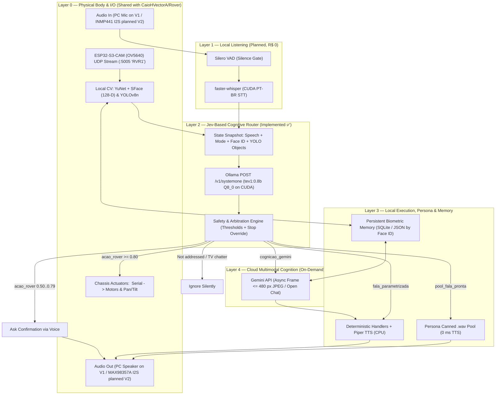

# 🤖 PETeleco — Cognitive Robotics, Persona & Layered AI Pipeline

🇺🇸 **English** | [🇧🇷 Leia em Português (BR)](README.pt-BR.md)

**PETeleco** is the cognitive AI, persona, and communication-protocol repository developed at **PET Elétrica UFF** ([`PetEletricaUFF`](https://github.com/PetEletricaUFF)). It implements an expressive, persona-driven embodied agent ("simulated sentience" — academically framed as **Cognitive Robotics / Embodied AI / Human-Robot Interaction**) capable of listening, speaking naturally in Brazilian Portuguese, recognizing people, maintaining face-indexed conversational memory, describing scenes, and safely commanding a physical mobile robot.

---

## 🔗 Inspiration & Parallel Development with `CaioHVectorA/Rover`

PETeleco is directly inspired by and developed in parallel with **[`CaioHVectorA/Rover`](https://github.com/CaioHVectorA/rover)**:

| Repository | Role in the Shared Research System | Scope |
|---|---|---|
| **[`CaioHVectorA/Rover`](https://github.com/CaioHVectorA/rover)** | **Physical Body & Low-Level Vision** | 4WD ABS chassis, KiCad PCB, `ESP32-S3-CAM` (`OV5640`), chassis MCU (`Nano V3` → `ESP32 DevKit`), UDP video stream, serial `<C,a,b,c>` actuation, and standalone CV modules (`YuNet + SFace`, `YOLOv8n`, `MediaPipe`). |
| **`PetEletricaUFF/PETeleco`** *(this repo)* | **Cognitive Brain, Persona & Protocols** | Layered local-first AI architecture, Jev-based probabilistic intent routing, speech pipeline (VAD/STT/TTS), persistent social memory per face, persona response policies, and motor safety gating. |

Both repositories share the **same physical robot hardware and host inference machine**, allowing mechatronics/firmware work and cognitive AI experiments to evolve cleanly without coupling CAD/firmware clutter into the AI codebase.

---

## 💡 Core Concept: Cost- & Latency-Aware Embodied Persona

Sending every detected phrase and camera frame directly to a cloud LLM/VLM makes a physical robot slow, expensive, and unsafe around motors (plus noisy when reacting to background chatter or TV audio).

PETeleco solves this with a **5-layer hierarchical pipeline**:
1. **Local-first triage & Wake-word gating (R$ 0 / low latency):** In continuous hands-free listening, *"Standby"* ignores ambient chatter until `"PETeleco"` triggers a rolling **60 s Active Listening** window. On RTX 3050 CUDA, SystemOne (`tev1:0.8b`) routes speech in **~353 ms** (`p50`); on CPU-only laptops (`--roteador auto`), a fast `Gemini Flash-Lite` JSON router runs in `~0.7–1.9 s` vs `~10–20 s` on CPU Ollama.
2. **Persona immediacy (`0 ms` TTS):** Greetings, wake-word acknowledgments, farewells, and confirmations trigger short persona responses / optional `.wav` clips without waiting on open LLM generation.
3. **Deterministic skills + Natural PT-BR TTS:** Date/time, weather, battery/temperature, and active face identity query local deterministic handlers and speak via neural **`Edge TTS`** (`pt-BR-AntonioNeural`, calm live-chat pacing) or **`Gemini TTS`**, with offline CPU **`Piper TTS`** fallback.
4. **Probabilistic motor safety interlocks:** Physical movement commands require high calibrated confidence (`>= 0.80` direct execution; `0.50–0.79` confirmation prompt; explicit emergency stop `>= 0.90` immediate cut).
5. **Cloud escalation strictly on demand:** Multimodal cloud cognition (`Gemini`) is invoked only when a visual scene description or open-ended conversational answer is genuinely needed.

---

## 🏗️ Layered Architecture



---

## 🧠 Models & Hardware Budget

Designed to keep **all active local models resident inside 8 GB VRAM** (host target: **NVIDIA GeForce RTX 3050 OEM 8 GB** + Intel Core i5-14600 + 16 GB DDR5):

| Layer | Component / Model | Role | Host / Runtime | Status |
|---|---|---|---|---|
| **L1 (Audio)** | `RMS VAD (450 ms pre-roll)` + `Gemini Audio STT` / `faster-whisper` (`small`) + `"PETeleco"` Wake-word | Continuous PT-BR transcription (`Standby <-> 60 s Active Listening`) + **256-D Neural GE2E** (`ge2e_256d`, CPU `0 MB` VRAM, 2-tier SNR-aware speaker check + `192-D` fallback) | Cloud STT / CPU / CUDA (`auto`) | **✅ Implemented & Tested** |
| **L2 (Router)** | **`tev1:0.8b`** (`772.85M`, `Q8_0`, `/v1/systemone`, **9 parallel questions**) + `Gemini Flash-Lite` JSON (`auto` CPU) | Parallel `noul`/`choice` routing (`+cerebro_persona`, `+skill_modular`) & hard safety locks | Ollama CUDA (`1245.7 MiB`) / API | **✅ Implemented & Benchmarked** |
| **L3 (Brains & Skills)** | **5 Multi-Brain Prompts** (`resenha`, `desgracado`, `tecnico`, `serio`, `utilitario`) + **9 Alexa-style Skills** | Real `user`/`model` few-shot injection + `clima`, ad-free headless `musica` (**18% audio ducking**), `noticias`, `recados`, `timer`, free `busca_web`, `sonoplastia` (`.wav` SFX), `listas`, `rotinas` | Local Python + `PyAV`/`sounddevice` (`0 MB` VRAM) | **✅ Implemented & Tested** |
| **L3 (Speech)** | **`Edge Neural TTS`** (`pt-BR-AntonioNeural`) / `Gemini TTS` + **`Piper TTS`** offline fallback | Natural PT-BR conversational speech synthesis via `sounddevice` / Pulse / ALSA | Online Neural / Offline CPU (`0 MB` VRAM) | **✅ Implemented & Tested** |
| **L3 (Vision)** | `YuNet` + `SFace` (ONNX, `128-D`) + `WebcamLive` HUD | Face biometric ID (`cosine >= 0.363`) & live `--preview` / MJPEG HUD | Local OpenCV ONNX (`0 MB` VRAM) | **✅ Implemented (`Rover` + `PETeleco`)** |
| **L3 (Vision)** | `YOLOv8n` + `MediaPipe Hands` | Object detection, trekking FSM & gestures | Local Python / ONNX | Validated in `Rover` |
| **L3 (Memory)** | **Embedded Knowledge Graph (`GrafoMemoriaSQLite`)** + Hot JSON Cards | 1–2 hop subgraph retrieval (`grafo_nos`/`grafo_arestas` in `memoria_longa.sqlite`), local regex extractor (`F1 = 0.941`, `0.18 ms`, `0` tokens) + hybrid mode (`F1 = 0.947`) | Local Disk (`data/`) (`0 MB` VRAM) | **✅ Implemented & Benchmarked** |
| **L4 (Cloud)** | `Gemini REST` + Ollama `/api/chat` fallback | Scene `Image-to-Text` & open chat routed by Jev across specialized brains | HTTPS REST API / local | **✅ Implemented (`GEMINI_API_KEY` optional)** |

---

## 🔌 Protocols Summary

- **Layer 2 Inference Protocol (`POST /v1/systemone`):** Structured textual `state` + **9 parallel typed questions** (`dirigido_ao_robo`, `rota_principal`, `pool_fala_pronta`, `fala_parametrizada`, `acao_rover`, `cognicao_gemini`, `precisa_imagem_camera`, `cerebro_persona`, `skill_modular`) returning calibrated probabilities in a single forward pass.
- **Zero-Delay UDP Video & Discovery (`Port 5005`, from `Rover`):** Custom `'RVR1'` (`0x52565231`) 16-byte `<IHHHHI` packet header, `HELLO` broadcast discovery, RTT ping (`P` + `<d`), and latest-frame socket draining without frame queue buildup.
- **ASCII Chassis Control Frames (`<C,a,b,c>`, from `Rover`):** Compact serial protocol for differential motors (`<M,esq,dir>`), microsecond-smoothed Pan/Tilt (`<S,pan10,tilt10,vel10>`), battery telemetry (`<B,mV,minmV>`), and emergency brake (`<X>`).

See [`docs/ARCHITECTURE.md`](docs/ARCHITECTURE.md) ([PT-BR](docs/ARCHITECTURE.pt-BR.md)) for full protocol details and state diagrams.

---

## 📊 Layer 2 Benchmark Results (Verified)

Measured on **Windows 11 / RTX 3050 OEM (8 GB VRAM) / Ollama v0.40.16 (`OLLAMA_VULKAN=0` forcing native CUDA0)** running [`src/benchmark_router.py`](src/benchmark_router.py) across **36 PT-BR test utterances** (**20 standard + 16 unseen out-of-sample generalization phrases**, 2 warm rounds = `72` calls):

| Metric | Measured Result |
|---|---|
| **Warm Latency (`n = 72`, 7 parallel questions)** | `min = 306.21 ms` \| `mean = 352.85 ms` \| **`p50 = 352.54 ms`** \| **`p95 = 376.05 ms`** \| `max = 491.71 ms` |
| **Model VRAM Footprint (`/api/ps`)** | **`1245.7 MiB`** (`keep_alive=-1`) |
| **Main Route Accuracy** | **`36 / 36 (100.0%)`** (`20/20` standard + `16/16` unseen generalization) |
| **Subtype Accuracy** | **`31 / 31 (100.0%)`** *(excluding 5 noise cases without expected subtype)* |
| **Camera-Need Detection (`precisa_imagem_camera`)** | **`34 / 34 (100.0%)`** |
| **Resolved Locally (Cloud API Savings)** | **`30 / 36 (83.3%)`** handled without calling Gemini |

> **Scope & Linux vs. Windows comparison:** The table above measures isolated Layer 2 routing on **RTX 3050 CUDA** (`352.5 ms` p50). On pure CPU on the Linux development laptop (**AMD Ryzen 7 5700U / Ollama v0.40.16 CPU**, `n=20`), routing accuracy stayed **`20/20 (100.0%)`** with warm latency `p50 = 9.73 s` (`min = 6.34 s` | `mean = 9.22 s`) — do not enable `OLLAMA_IGPU_ENABLE=1` on AMD Renoir RADV APUs, as Vulkan stalls after `load_tensors`.  
> **Windows CUDA tip:** On Windows, Ollama `v0.40.16` defaults to Vulkan (`14.19 s` initial shader compilation). Set `OLLAMA_VULKAN=0` before `ollama serve` to force CUDA (`CUDA0`). Initial cold load after boot takes ~27–45 s (Ollama disables `mmap` on `windows_cuda`), then stays resident in VRAM at ~353 ms per call (`496.1 ms` cold call when already loaded).

---

## 💻 Hardware & Cloud Resource Footprint (Current Architecture)

Measured/projected resource usage for the full pipeline (**Multi-Brain + 9 Alexa-style Skills + SQLite Knowledge Graph + GE2E Voice ID + Jev Router + Vision/STT/TTS**) on the target host PC (**NVIDIA RTX 3050 8 GB VRAM + Intel Core i5-14600 + 16 GB DDR5**):

| Subsystem / Layer | VRAM (`RTX 3050 8 GB`) | System RAM | CPU / Inference Latency | Local Disk |
|---|---|---|---|---|
| **L1 — VAD + `faster-whisper small`** (`float16` CUDA; `0 MiB` via `Gemini Audio` on CPU) | `~1050–1200 MiB` *(or `0 MiB`)* | `~350 MB` | `~350–650 ms` warm CUDA | `~485 MB` |
| **L1 — Neural GE2E Voice Biometrics** (`ge2e_256d`, 3-layer LSTM CPU) | **`0 MiB`** | `~45 MB` | `~25–45 ms` / utterance | `17.1 MB` (`voice_encoder_ge2e.pt`) |
| **L2 — Jev Router `tev1:0.8b`** (`Q8_0`, Ollama `CUDA0`, `OLLAMA_VULKAN=0`, `keep_alive=-1`) | **`1245.7 MiB`** | `~400 MB` | **`p50 = 388.5 ms`** (9 parallel questions) | `~810 MB` (`C:\Ollama`) |
| **L3 — Local Vision (`YuNet + SFace` OpenCV DNN CPU)** | **`0 MiB`** | `~60 MB` | **`~10.8 ms`** / frame | `~37 MB` |
| **L3 — Multi-Brain + Knowledge Graph + 9 Skills** (`GrafoMemoriaSQLite`) | **`0 MiB`** | `< 25 MB` | **`0.18 ms`** local extract + `< 1.5 ms` 2-hop query | `< 5 MB` (`~5–10 MB/yr`) |
| **L3 — Headless Music (`PyAV + sounddevice`, 18% Ducking) & TTS (`Edge` / `Piper` CPU)** | **`0 MiB`** | `~80 MB` | `< 2%` of 1 core (music) / `~260–400 ms` (Piper) | `~60 MB` (`Piper` + `.wav` SFX) |
| **Total Active Host PC Footprint** | **`~2.3–2.5 GB` (~30% of 8 GB; ~5.5 GB free)** | **`~1.1–1.4 GB` (< 9% of 16 GB)** | **Sub-second local routing & skills** | **`~1.4 GB` total** |

- **Cloud API Quota Budget (`Gemini 3.5 Flash-Lite` Free Tier):**
  - `~78–83%` of turns (`ignorar`, `pool_fala_pronta`, `fala_parametrizada`, `acao_rover`, `timer`, `listas`, `recados`, `musica`, `sonoplastia`) consume **`0` Gemini calls**.
  - Open chat / narrated skill turns consume **1 REST call** (`~1050–1320` input tokens + `~20–85` output tokens — cutting input tokens by ~25–35% vs. the monolithic prompt via Multi-Brain + 2-hop graph injection).
  - `local` graph extraction (`F1 = 0.941` across 12-case benchmark) and `busca_web` (`AwesomeAPI` + `ddgs` + `Wikipedia`) consume **`0` extra paid calls**.
- **Embedded Robot Power Budget (`Rover` V1 → V2 PCB on `2S 7.4V 2500mAh` + `Mini 560 5V/5A`):**
  - All AI inference executes on the host PC. The robot body only draws `~180–260 mA @ 5V` (`ESP32-S3-CAM`), plus V2 `ESP32 DevKit V1` (`~120 mA`), `INMP441` (`~1 mA`), `SSD1306` (`~15 mA`), and `MAX98357A` I2S amp (`~150–300 mA` avg ambient music at 18–35% volume, `~600 mA` peak at 3W) — well inside the `5.0V / 5A` step-down rail.

---

## 📂 Repository Structure

```text
PETeleco/
├── README.md                   # English documentation
├── README.pt-BR.md             # Documentação em Português (BR)
├── AGENTS.md                   # AI engineering rules & shared Rover/PETeleco context (EN)
├── AGENTS.pt-BR.md             # Diretrizes para agentes & contexto paralelo (PT-BR)
├── .env.example                # Environment variable template (GEMINI_API_KEY, etc.)
├── requirements.txt            # Runtime deps (skills, headless audio, STT/TTS) + PyTorch notes
├── prompts/
│   ├── persona_peteleco.md     # Legacy monolithic reference prompt (v8.0)
│   └── cerebros/               # Multi-Brain modular prompts routed by Jev
│       ├── resenha.md          # Light, witty companion (default casual brain)
│       ├── desgracado.md       # Unfiltered roast mode (blocked for professors/SERIO)
│       ├── tecnico.md          # Engineering & electrical helper (temp=0.35)
│       ├── serio.md            # Respectful formal lock (Tutor / SERIO mode)
│       └── utilitario.md       # Natural Alexa-style narration for live DADOS_SKILL
├── data/
│   ├── perfis_pessoas.json     # Hot profile cards & phonetic aliases for the PET lab team
│   ├── known_faces.json        # SFace 128-D face embeddings (YuNet + SFace)
│   └── known_voices.json       # 256-D GE2E voice embedding database for camera-free speaker ID
├── docs/
│   ├── context.md              # Continuous research memory & hardware constraints (EN)
│   ├── context.pt-BR.md        # Memória técnica contínua e contexto físico (PT-BR)
│   ├── ARCHITECTURE.md         # Deep-dive protocols, safety gates & models (EN)
│   └── ARCHITECTURE.pt-BR.md   # Protocolos, travas de segurança e modelos (PT-BR)
├── tests/
│   ├── test_arena_prompts.py       # Prompt Arena regression tests
│   ├── test_studio_prompt.py       # Prompt Studio API & SSE tests
│   └── test_arquitetura_modular.py # Multi-Brain, 9 Skills, Knowledge Graph & GE2E Voice ID tests (28/28 OK)
└── src/
    ├── __init__.py
    ├── escuta_stt.py               # Layer 1: Mic capture (pre-roll VAD + music ducking) + STT (Gemini Audio / faster-whisper)
    ├── voz_biometria.py            # Layer 1: CPU Neural 256-D GE2E Speaker ID + 2-tier SNR gate (`192-D` fallback)
    ├── router_systemone.py         # Layer 2: Jev (`/v1/systemone`, 9 parallel questions) + Flash-Lite JSON + Active Listening
    ├── cerebros.py                 # Layer 3: Multi-Brain loader, frontmatter parser, few-shot dialogue & safety locks
    ├── grafo_memoria.py            # Layer 3: SQLite Knowledge Graph (`grafo_nos`/`grafo_arestas`, 2-hop subgraph retrieval)
    ├── memoria_pessoas.py          # Layer 3: 3-tier memory (hot JSON card + cold SQLite + Graph hook)
    ├── tts_local.py                # Layer 3: Edge Neural / Gemini TTS + Piper TTS fallback + music ducking
    ├── visao_webcam.py             # Layer 3: Thread-safe WebcamLive capture + YuNet/SFace HUD
    ├── persona_peteleco.py         # Layer 3/4: Multi-Brain persona orchestration, Skills dispatch & Gemini REST
    ├── prompt_metrics.py           # Token/latency/rating telemetry helpers
    ├── testar_peteleco.py          # Live simulator & workbench CLI
    ├── ui_peteleco.py              # Local Web UI (MJPEG YuNet+SFace + SSE under-the-hood telemetry)
    ├── studio_prompt.py            # Prompt Studio UI (multi-turn rating, Multi-Brain .md editor & Skills trace)
    ├── arena_prompts.py            # Automated LLM-as-a-Judge & A/B prompt calibration server
    ├── benchmark_router.py         # 36-case isolated Layer 2 Jev router benchmark suite
    ├── benchmark_grafo.py          # 12-case Knowledge Graph Precision/Recall/F1 benchmark
    ├── skills/                     # 9 Plug-and-Play Alexa-Style Skills (`SkillBase`)
    │   ├── __init__.py
    │   ├── base.py
    │   ├── busca_web.py            # Free BRL quotes (AwesomeAPI) + ddgs + Wikipedia PT
    │   ├── clima.py                # Live Niterói/RJ weather (Open-Meteo, 0 API key)
    │   ├── listas.py               # Graph-backed shopping & lab lists (0 ms LLM)
    │   ├── musica.py               # Ad-free headless player (PyAV+sounddevice, ytmusicapi, SoundCloud, SomaFM, 18% ducking)
    │   ├── noticias.py             # Live RSS feeds (G1, Tecnoblog, GE)
    │   ├── recados.py              # Person-indexed SQLite pending notes (auto-delivered on face/voice ID)
    │   ├── rotinas.py              # Alexa routines ("bom_dia", "modo_estudo")
    │   ├── sonoplastia.py          # Deterministic .wav SFX synthesizer + anti-cringe gate
    │   └── timer.py                # Background threaded timers + TTS callback
    └── static/
        ├── ui_peteleco.html        # Dependency-free Web UI frontend
        ├── studio_prompt.html      # Prompt Studio Web frontend
        └── arena_prompts.html      # Prompt Arena Web frontend
```

---

## 🚀 Quickstart (Full Live Pipeline on Linux CPU or Windows CUDA)

1. Install Ollama (`>= v0.35`, verified on `v0.40.16`) and pull `tev1:0.8b`:
   ```bash
   ollama pull tev1:0.8b
   ```
2. Start the Ollama server:
   - **Linux (CPU / laptop without NVIDIA GPU):**
     ```bash
     ollama serve
     ```
   - **Windows (RTX 3050 lab PC — force CUDA instead of Vulkan):**
     ```powershell
     $env:OLLAMA_VULKAN="0"
     ollama serve
     ```
3. Create a Python virtual environment and install the full simulator stack:
   - **Linux (CPU-only PyTorch so you don't download ~3 GB of CUDA wheels):**
     ```bash
     python3 -m venv .venv
     source .venv/bin/activate
     pip install --index-url https://download.pytorch.org/whl/cpu torch torchaudio
     pip install -r requirements.txt numpy sounddevice faster-whisper opencv-python piper-tts edge-tts
     ```
     *(If using `uv`: `uv pip install --python .venv/bin/python ...`)*
   - **Windows (NVIDIA CUDA):**
     ```powershell
     python -m venv .venv
     .\.venv\Scripts\Activate.ps1
     pip install -r requirements.txt numpy sounddevice faster-whisper opencv-python piper-tts edge-tts
     pip install torch torchaudio --index-url https://download.pytorch.org/whl/cu124
     ```
4. *(Recommended for Layer 1/2/4 `Gemini` STT, fast CPU routing & cloud VLM; offline mode also works)* Copy `.env.example` to `.env` (or reuse `../rover/.env`) and set `GEMINI_API_KEY`. Without a key, local layers (`pool_fala_pronta`, `fala_parametrizada`, `acao_rover` table-edge safety interlocks, `YuNet+SFace`, local `faster-whisper small`, `tev1:0.8b`, and `Piper TTS`) still run 100% offline.
5. Launch the **live Web UI (MJPEG webcam with YuNet+SFace + Under-the-Hood telemetry + Escuta Ativa + Natural PT-BR TTS)** or the CLI workbench:
   ```bash
   # Local Web UI (auto-starts local Ollama, opens browser + webcam + engine selectors):
   python -m src.ui_peteleco

   # Or hands-free CLI workbench (say "PETeleco" to open a 60 s Active Listening window):
   python -m src.testar_peteleco --preview --continuo --tts

   # Isolated 36-case Layer 2 benchmark:
   python src/benchmark_router.py --suite todas --rodadas 2
   ```
   - **First run:** `YuNet`, `SFace` (`models/`), and `pt_BR-faber-medium` Piper voice files (`models/piper/`) download automatically as offline backups.
   - **STT, TTS & Router options:** `--roteador auto` uses Jev on CUDA GPUs and `Gemini Flash-Lite` on CPU-only laptops (`--roteador jev` forces local Ollama). `--stt-modo auto` tries `Gemini Audio` first on CPU (falling back to `faster-whisper small`); `--tts-modo auto` uses `Edge Neural` (`pt-BR-AntonioNeural`, switchable in the UI or via `--tts-voz`) with `Gemini TTS` and offline `Piper TTS` fallbacks.
   - **Wake-word & Mic tuning:** In continuous mode (`--continuo` or UI toggle), ambient speech is ignored in *Standby* until you say **`"PETeleco"`**, which opens a rolling 60 s *Active Listening* window (disable via `--sem-wake-word` or the UI `Wake "PETeleco"` button). Adjust mic sensitivity with `--mic <index>` (list via `/mics`) and `--limiar-mic 0.012`.
   - **Useful workbench commands:** empty `[ENTER]` for a single mic turn, `/continuo` to toggle hands-free continuous listening, `/preview` to toggle the live HUD window, `/rosto <name>` and `/voz <name>` to enroll your face/voice, `/corpo <chao|bancada|no_colo>` to test table-edge safety locks, `/foto <file> [prompt]` to test image input, and `/perfil` to inspect 3-tier memory.
