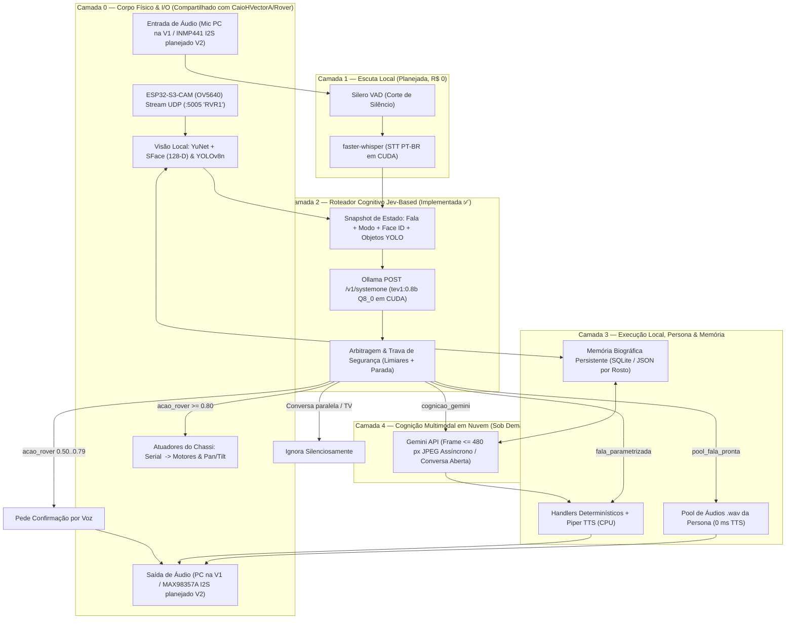

# 🤖 PETeleco — Robótica Cognitiva, Persona & Pipeline de IA em Camadas

[🇺🇸 Read in English](README.md) | 🇧🇷 **Português (BR)**

**PETeleco** é o repositório dedicado à arquitetura de IA cognitiva, construção de persona e protocolos de comunicação desenvolvido no **PET Elétrica UFF** ([`PetEletricaUFF`](https://github.com/PetEletricaUFF)). O projeto implementa um agente incorporado expressivo com simulação de senciência (academicamente enquadrado como **Robótica Cognitiva / Embodied AI / Interação Humano-Robô — HRI**), capaz de ouvir, conversar em Português (BR), reconhecer pessoas, manter memória biográfica por rosto, descrever cenas e acionar o corpo físico com segurança.

---

## 🔗 Inspiração & Desenvolvimento Paralelo com `CaioHVectorA/Rover`

O `PETeleco` é diretamente inspirado e desenvolvido em paralelo com o projeto **[`CaioHVectorA/Rover`](https://github.com/CaioHVectorA/rover)**:

| Repositório | Papel no Sistema Compartilhado | Escopo |
|---|---|---|
| **[`CaioHVectorA/Rover`](https://github.com/CaioHVectorA/rover)** | **Corpo Físico & Visão Embarcada** | Chassi 4WD em ABS, PCB KiCad, `ESP32-S3-CAM` (`OV5640`), controlador do chassi (`Nano V3` → `ESP32 DevKit`), vídeo UDP, protocolo serial `<C,a,b,c>` e scripts de visão (`YuNet + SFace`, `YOLOv8n`, `MediaPipe`). |
| **`PetEletricaUFF/PETeleco`** *(este repo)* | **Cérebro Cognitivo, Persona & Protocolos** | Arquitetura hierárquica local-first, roteamento probabilístico Jev-based, pipeline de voz (VAD/STT/TTS), memória persistente indexada por rosto, persona e travas probabilísticas de segurança. |

Os dois repositórios evoluem em paralelo sobre o **mesmo contexto físico e hardware de pesquisa**, mantendo o repositório de IA simples e desacoplado de desenhos CAD, esquemáticos e firmwares C++.

---

## 💡 A Ideia: Persona Incorporada Orientada a Custo e Latência

Mandar toda frase capturada pelo microfone e todo frame de câmera para um LLM/VLM na nuvem torna o robô lento, caro, vulnerável a conversas paralelas no ambiente e arriscado para movimentar motores diretamente.

O **PETeleco** resolve isso com uma **arquitetura hierárquica em 5 camadas**:
1. **Triagem local imediata (R$ 0 / baixa latência):** Um roteador SystemOne leve avalia fala + estado dos sensores em **~353 ms** (`p50`) antes de acionar áudio pesado ou nuvem — ignorando conversas paralelas e TV.
2. **Resposta social instantânea (`0 ms` de TTS):** Saudações, despedidas, confirmações e elogios disparam áudios `.wav` pré-gravados da persona do PETeleco, sem depender de síntese nem API externa.
3. **Funções determinísticas + TTS local:** Hora/data, clima, bateria/temperatura e identificação facial usam handlers locais determinísticos com síntese offline em CPU (**`Piper TTS`**).
4. **Travas probabilísticas de segurança motora:** Comandos físicos exigem confiança calibrada (`>= 0,80` execução direta; `0,50–0,79` pede confirmação por voz; parada explícita `>= 0,90` corta imediatamente).
5. **Nuvem estritamente sob demanda:** A API multimodal (`Gemini`) só entra quando o roteador classifica necessidade real de `Image-to-Text` ou conversa aberta complexa.

---

## 🏗️ Arquitetura em Camadas



---

## 🧠 Modelos Utilizados & Orçamento de VRAM

Projetado para manter **todos os modelos ativos residentes dentro de 8 GB de VRAM** (máquina-alvo: **NVIDIA GeForce RTX 3050 OEM 8 GB** + Intel Core i5-14600 + 16 GB DDR5):

| Camada | Componente / Modelo | Função | Execução | Status |
|---|---|---|---|---|
| **C1 (Áudio)** | `Silero VAD` | Corta silêncio antes do STT | CPU / Python Local | Planejado |
| **C1 (Áudio)** | `faster-whisper` (`base` / `small`) | Transcrição contínua em PT-BR | GPU CUDA (`~0,5–1,0 GB` VRAM) | Planejado |
| **C2 (Roteador)** | **`tev1:0.8b`** (`772.85M`, `Q8_0`, `qwen35`) | Avaliação paralela `noul`/`choice` em `/v1/systemone` | Ollama CUDA (`1245,7 MiB` VRAM) | **✅ Implementado e Testado** |
| **C3 (Voz)** | `Piper TTS` + Pool `.wav` | Síntese local de voz PT-BR da persona | CPU (`~0 GB` VRAM) | Planejado |
| **C3 (Visão)** | `YuNet` + `SFace` (ONNX, `128-D`) | Detecção facial e biometria (`cosseno >= 0,363`) | OpenCV ONNX local | Validado no `Rover` |
| **C3 (Visão)** | `YOLOv8n` + `MediaPipe Hands` | Objetos, máquina de estados trekking e gestos | Python / ONNX local | Validado no `Rover` |
| **C3 (Memória)** | `SQLite` / `JSON` | Fatos e resumos de conversa por pessoa | Disco local | Planejado |
| **C4 (Nuvem)** | `Gemini` (`gemini-3.5-flash` base) | `Image-to-Text` da cena e conversa aberta | API REST HTTPS assíncrona | Cliente validado no `Rover` |

---

## 🔌 Resumo dos Protocolos

- **Contrato da Camada 2 (`POST /v1/systemone`):** Envia snapshot `state` + 7 perguntas tipadas em paralelo (`dirigido_ao_robo`, `rota_principal`, `pool_fala_pronta`, `fala_parametrizada`, `acao_rover`, `cognicao_gemini`, `precisa_imagem_camera`), devolvendo escolhas e probabilidades calibradas em uma única passada.
- **Streaming UDP Zero-Buffer (`Porta 5005`, herdado do `Rover`):** Cabeçalho binário `'RVR1'` (`0x52565231`, 16 bytes `<IHHHHI`), descoberta via broadcast `HELLO`, ping RTT e dreno contínuo para ler sempre o quadro mais recente sem fila acumulada.
- **Protocolo Serial ASCII (`<C,a,b,c>`, herdado do `Rover`):** Quadros curtos para motores diferenciais (`<M,esq,dir>`), Pan/Tilt suavizado (`<S,pan10,tilt10,vel10>`), bateria (`<B,mV,minmV>`) e parada de emergência (`<X>`).

Consulte [`docs/ARCHITECTURE.pt-BR.md`](docs/ARCHITECTURE.pt-BR.md) ([English](docs/ARCHITECTURE.md)) para especificações completas e regras de arbitragem.

---

## 📊 Resultados Reais de Benchmark — Camada 2 (Verificado)

Medido em **Windows 11 / RTX 3050 OEM (8 GB VRAM) / Ollama v0.40.16 (`OLLAMA_VULKAN=0` forçando CUDA0)** executando [`src/benchmark_router.py`](src/benchmark_router.py) sobre **36 frases em PT-BR** (**20 padrão + 16 inéditas de generalização**, 2 rodadas warm = `72` chamadas):

| Métrica | Resultado Medido |
|---|---|
| **Latência Warm (`n = 72`, 7 perguntas paralelas)** | `min = 306,21 ms` \| `média = 352,85 ms` \| **`p50 = 352,54 ms`** \| **`p95 = 376,05 ms`** \| `max = 491,71 ms` |
| **VRAM Ocupada (`/api/ps`)** | **`1245,7 MiB`** (`keep_alive=-1`) |
| **Acurácia da Rota Principal** | **`36 / 36 (100,0%)`** (`20/20` padrão + `16/16` inéditas) |
| **Acurácia do Subtipo** | **`31 / 31 (100,0%)`** *(excluindo os 5 casos de ruído sem subtipo)* |
| **Detecção de Câmera (`precisa_imagem_camera`)** | **`34 / 34 (100,0%)`** |
| **Resolução Local (Economia de API)** | **`30 / 36 (83,3%)`** resolvidos sem chamar o Gemini |

> **Escopo do teste:** Mede exclusivamente acurácia de roteamento e latência HTTP sobre texto PT-BR + contexto simulado dos sensores (`SFace`/`YOLO`/estado). Captura ao vivo de microfone + VAD + Whisper, `Piper TTS` e integração com o robô físico seguem como próximas etapas.  
> **Nota prática no Windows:** Por padrão no Windows, o Ollama `v0.40.16` sobe em backend Vulkan (`14,19 s` compilando shaders na 1ª chamada). Defina `OLLAMA_VULKAN=0` antes do `ollama serve` para forçar `CUDA0`. A primeira carga fria pós-boot em CUDA leva ~27–45 s (`mmap` desativado em `windows_cuda`), mantendo-se residente em seguida (`496,1 ms` no warm-reload).

---

## 📂 Estrutura do Repositório

```text
PETeleco/
├── README.md                   # Documentação em Inglês
├── README.pt-BR.md             # Documentação em Português (BR)
├── AGENTS.md                   # Diretrizes para agentes & contexto paralelo (EN)
├── AGENTS.pt-BR.md             # Diretrizes para agentes & contexto paralelo (PT-BR)
├── requirements.txt            # Dependências mínimas (`requests` para C2)
├── prompts/
│   └── persona_peteleco.md     # System Prompt v3.1 (fonte única da persona & memória)
├── data/
│   ├── perfis_pessoas.json     # Ficha quente dos perfis e apelidos do PET Elétrica
│   └── known_voices.json       # Banco de embeddings vocais para identificação por voz
├── docs/
│   ├── context.md              # Memória técnica contínua e restrições físicas (EN)
│   ├── context.pt-BR.md        # Memória técnica contínua e restrições físicas (PT-BR)
│   ├── ARCHITECTURE.md         # Protocolos, travas e modelos (Inglês)
│   └── ARCHITECTURE.pt-BR.md   # Protocolos, travas e modelos (Português-BR)
└── src/
    ├── __init__.py
    ├── escuta_stt.py           # Camada 1: Microfone (VAD) + STT (faster-whisper / Gemini Audio)
    ├── voz_biometria.py        # Camada 1: Speaker Verification na CPU (sem câmera)
    ├── router_systemone.py     # Camada 2: Roteador cognitivo Jev-based (/v1/systemone)
    ├── memoria_pessoas.py      # Camada 3: Memória em 3 camadas (JSON quente + SQLite frio)
    ├── persona_peteleco.py     # Camada 3/4: Motor da persona, estado corporal e Gemini REST
    ├── testar_peteleco.py      # Bancada interativa completa (Voz + STT + Jev + Persona)
    └── benchmark_router.py     # Bateria de benchmark isolado (36 casos)
```

---

## 🚀 Como Rodar Agora (Bancada Completa + Camada 2)

1. Instale o Ollama (`>= v0.35`, testado na `v0.40.16`) e baixe o modelo `tev1:0.8b`:
   ```powershell
   ollama pull tev1:0.8b
   ```
2. Suba o servidor forçando CUDA no Windows (`OLLAMA_VULKAN=0`):
   ```powershell
   $env:OLLAMA_VULKAN="0"
   ollama serve
   ```
3. Instale as dependências Python e configure `GEMINI_API_KEY` num arquivo `.env` na raiz (ou use o `.env` compartilhado na pasta irmã `../rover/.env`):
   ```powershell
   pip install -r requirements.txt
   ```
4. Rode o benchmark da Camada 2 (36 casos) ou a **bancada completa interativa (Voz + STT + Jev + Persona)**:
   ```powershell
   python src/benchmark_router.py --suite todas --rodadas 2
   python -m src.testar_peteleco
   ```
   > Na bancada interativa: pressione `ENTER` vazio para falar no microfone, `/voz caio` para cadastrar sua voz em 4 segundos, `/testar_voz` para checar o reconhecimento vocal, `/corpo bancada` para testar a trava de altura e `/perfil` para inspecionar a evolução da memória.
