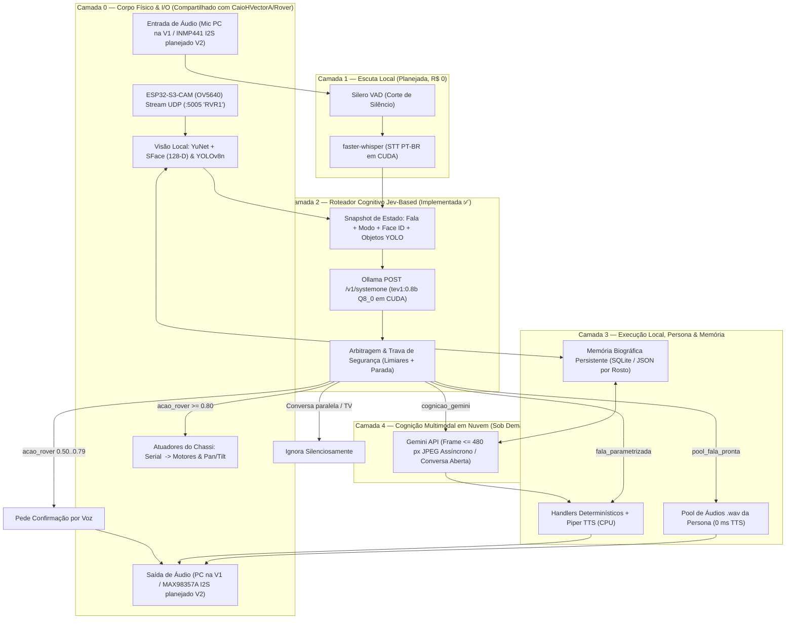

# 🤖 PETeleco — Robótica Cognitiva, Persona & Pipeline de IA em Camadas

[🇺🇸 Read in English](README.md) | 🇧🇷 **Português (BR)**

**PETeleco** é o repositório dedicado à arquitetura de IA cognitiva, construção de persona e protocolos de comunicação desenvolvido no **PET Elétrica UFF** ([`PetEletricaUFF`](https://github.com/PetEletricaUFF)). O projeto implementa um agente incorporado expressivo com simulação de senciência (academicamente enquadrado como **Robótica Cognitiva / Embodied AI / Interação Humano-Robô — HRI**), capaz de ouvir, conversar em Português (BR), reconhecer pessoas, manter memória biográfica por rosto, descrever cenas e acionar o corpo físico com segurança.

---

## 🔗 Inspiração & Desenvolvimento Paralelo com `CaioHVectorA/Rover`

O `PETeleco` é diretamente inspirado e desenvolvido em paralelo com o projeto **[`CaioHVectorA/Rover`](https://github.com/CaioHVectorA/rover)**:

| Repositório | Papel no Sistema Compartilhado | Escopo |
|---|---|---|
| **[`CaioHVectorA/Rover`](https://github.com/CaioHVectorA/rover)** | **Corpo Físico & Visão Embarcada** | Chassi 4WD em ABS, PCB KiCad, `ESP32-S3-CAM` (`OV5640`), controlador do chassi (`Nano V3` → `ESP32 DevKit`), vídeo UDP, protocolo serial `<C,a,b,c>` e scripts de visão (`YuNet + SFace`, `YOLOv8n`, `MediaPipe`). |
| **`PetEletricaUFF/PETeleco`** *(este repo)* | **Cérebro Cognitivo, Persona & Protocolos** | Arquitetura hierárquica local-first, roteamento probabilístico Jev-based, pipeline de voz (VAD/STT/TTS), memória persistente indexada por rosto, persona e travas probabilísticas de segurança. |

Os dois repositórios evoluem em paralelo sobre o **mesmo contexto físico e hardware de pesquisa**, mantendo o repositório de IA simples e desacoplado de desenhos CAD, esquemáticos e firmwares C++.

---

## 💡 A Ideia: Persona Incorporada Orientada a Custo e Latência

Mandar toda frase capturada pelo microfone e todo frame de câmera para um LLM/VLM na nuvem torna o robô lento, caro, vulnerável a conversas paralelas no ambiente e arriscado para movimentar motores diretamente.

O **PETeleco** resolve isso com uma **arquitetura hierárquica em 5 camadas**:
1. **Triagem local & Wake-word imediata (R$ 0 / baixa latência):** No modo contínuo mãos-livres, o modo *"Standby"* ignora conversas paralelas até você dizer `"PETeleco"`, abrindo uma janela rolante de **60 s de Escuta Ativa**. Na RTX 3050 CUDA, o SystemOne (`tev1:0.8b`) roteia a fala em **~353 ms** (`p50`); em notebooks só com CPU (`--roteador auto`), o roteador JSON `Gemini Flash-Lite` decide em `~0,7–1,9 s` contra `~10–20 s` no Ollama em CPU.
2. **Resposta social instantânea (`0 ms` de LLM):** Saudações, confirmações de wake-word, despedidas e elogios disparam respostas/áudios curtos da persona do PETeleco sem depender de geração em nuvem.
3. **Funções determinísticas + TTS natural PT-BR:** Data/hora, clima, bateria/temperatura e identificação facial usam handlers determinísticos com síntese neural **`Edge TTS`** (`pt-BR-AntonioNeural`, ritmo natural de conversa) ou **`Gemini TTS`**, com fallback offline em CPU (**`Piper TTS`**).
4. **Travas probabilísticas de segurança motora:** Comandos físicos exigem confiança calibrada (`>= 0,80` execução direta; `0,50–0,79` pede confirmação por voz; parada explícita `>= 0,90` corta imediatamente).
5. **Nuvem estritamente sob demanda:** A API multimodal (`Gemini`) só entra quando o roteador classifica necessidade real de `Image-to-Text` ou conversa aberta com humor orgânico.

---

## 🏗️ Arquitetura em Camadas



---

## 🧠 Modelos Utilizados & Orçamento de VRAM

Projetado para manter **todos os modelos ativos residentes dentro de 8 GB de VRAM** (máquina-alvo: **NVIDIA GeForce RTX 3050 OEM 8 GB** + Intel Core i5-14600 + 16 GB DDR5):

| Camada | Componente / Modelo | Função | Execução | Status |
|---|---|---|---|---|
| **C1 (Áudio)** | `VAD RMS (pre-roll 450 ms)` + `Gemini Audio STT` / `faster-whisper` (`small`) + Wake-word `"PETeleco"` | Transcrição PT-BR (`Standby <-> Escuta Ativa 60 s`) + biometria vocal `torchaudio_192d` | Cloud STT / CPU / CUDA (`auto`) | **✅ Implementado e Testado** |
| **C2 (Roteador)** | **`tev1:0.8b`** (`772.85M`, `Q8_0`, `/v1/systemone`) + JSON `Gemini Flash-Lite` (`auto` CPU) | Avaliação paralela `noul`/`choice` (CUDA) ou triagem rápida em JSON (CPU) | Ollama CUDA (`1245,7 MiB`) / API | **✅ Implementado e Benchmarked** |
| **C3 (Voz)** | **`Edge Neural TTS`** (`pt-BR-AntonioNeural`) / `Gemini TTS` + fallback **`Piper TTS`** offline | Síntese conversacional PT-BR via `sounddevice` / Pulse / ALSA | Neural Online / CPU Offline (`~0 GB`) | **✅ Implementado e Testado** |
| **C3 (Visão)** | `YuNet` + `SFace` (ONNX, `128-D`) + `WebcamLive` HUD | Detecção facial, biometria (`>= 0,363`) e preview ao vivo `--preview` | OpenCV ONNX local | **✅ Implementado (`Rover` + `PETeleco`)** |
| **C3 (Visão)** | `YOLOv8n` + `MediaPipe Hands` | Objetos, máquina de estados trekking e gestos | Python / ONNX local | Validado no `Rover` |
| **C3 (Memória)** | `SQLite` / `JSON` em 3 camadas | Fatos quentes e episódios por pessoa reconhecida | Disco local (`data/`) | **✅ Implementado e Testado** |
| **C4 (Nuvem)** | `Gemini REST` + fallback Ollama `/api/chat` | `Image-to-Text` da cena e conversa aberta (com trava física) | HTTPS REST API / local | **✅ Implementado (requer `GEMINI_API_KEY`)** |

---

## 🔌 Resumo dos Protocolos

- **Contrato da Camada 2 (`POST /v1/systemone`):** Envia snapshot `state` + 7 perguntas tipadas em paralelo (`dirigido_ao_robo`, `rota_principal`, `pool_fala_pronta`, `fala_parametrizada`, `acao_rover`, `cognicao_gemini`, `precisa_imagem_camera`), devolvendo escolhas e probabilidades calibradas em uma única passada.
- **Streaming UDP Zero-Buffer (`Porta 5005`, herdado do `Rover`):** Cabeçalho binário `'RVR1'` (`0x52565231`, 16 bytes `<IHHHHI`), descoberta via broadcast `HELLO`, ping RTT e dreno contínuo para ler sempre o quadro mais recente sem fila acumulada.
- **Protocolo Serial ASCII (`<C,a,b,c>`, herdado do `Rover`):** Quadros curtos para motores diferenciais (`<M,esq,dir>`), Pan/Tilt suavizado (`<S,pan10,tilt10,vel10>`), bateria (`<B,mV,minmV>`) e parada de emergência (`<X>`).

Consulte [`docs/ARCHITECTURE.pt-BR.md`](docs/ARCHITECTURE.pt-BR.md) ([English](docs/ARCHITECTURE.md)) para especificações completas e regras de arbitragem.

---

## 📊 Resultados Reais de Benchmark — Camada 2 (Verificado)

Medido em **Windows 11 / RTX 3050 OEM (8 GB VRAM) / Ollama v0.40.16 (`OLLAMA_VULKAN=0` forçando CUDA0)** executando [`src/benchmark_router.py`](src/benchmark_router.py) sobre **36 frases em PT-BR** (**20 padrão + 16 inéditas de generalização**, 2 rodadas warm = `72` chamadas):

| Métrica | Resultado Medido |
|---|---|
| **Latência Warm (`n = 72`, 7 perguntas paralelas)** | `min = 306,21 ms` \| `média = 352,85 ms` \| **`p50 = 352,54 ms`** \| **`p95 = 376,05 ms`** \| `max = 491,71 ms` |
| **VRAM Ocupada (`/api/ps`)** | **`1245,7 MiB`** (`keep_alive=-1`) |
| **Acurácia da Rota Principal** | **`36 / 36 (100,0%)`** (`20/20` padrão + `16/16` inéditas) |
| **Acurácia do Subtipo** | **`31 / 31 (100,0%)`** *(excluindo os 5 casos de ruído sem subtipo)* |
| **Detecção de Câmera (`precisa_imagem_camera`)** | **`34 / 34 (100,0%)`** |
| **Resolução Local (Economia de API)** | **`30 / 36 (83,3%)`** resolvidos sem chamar o Gemini |

> **Escopo e comparação Linux vs. Windows:** A tabela acima mede o roteador isolado em **RTX 3050 CUDA** (`352,5 ms` p50). Em execução CPU pura no notebook de desenvolvimento (**Linux / AMD Ryzen 7 5700U / Ollama v0.40.16 CPU**, `n=20`), a acurácia manteve **`20/20 (100,0%)`** com latência warm `p50 = 9,73 s` (`min = 6,34 s` | `média = 9,22 s`) — não ative `OLLAMA_IGPU_ENABLE=1` em APUs AMD Renoir RADV, pois o driver Vulkan trava após `load_tensors`.  
> **Nota prática no Windows:** Por padrão no Windows, o Ollama `v0.40.16` sobe em backend Vulkan (`14,19 s` compilando shaders na 1ª chamada). Defina `OLLAMA_VULKAN=0` antes do `ollama serve` para forçar `CUDA0`. A primeira carga fria pós-boot em CUDA leva ~27–45 s (`mmap` desativado em `windows_cuda`), mantendo-se residente em seguida (`496,1 ms` no warm-reload).

---

## 📂 Estrutura do Repositório

```text
PETeleco/
├── README.md                   # Documentação em Inglês
├── README.pt-BR.md             # Documentação em Português (BR)
├── AGENTS.md                   # Diretrizes para agentes & contexto paralelo (EN)
├── AGENTS.pt-BR.md             # Diretrizes para agentes & contexto paralelo (PT-BR)
├── .env.example                # Modelo das variáveis de ambiente (GEMINI_API_KEY etc.)
├── requirements.txt            # Dependências base + comentários das opcionais
├── prompts/
│   └── persona_peteleco.md     # System Prompt v3.1 (fonte única da persona & memória)
├── data/
│   ├── perfis_pessoas.json     # Ficha quente dos perfis e apelidos do PET Elétrica
│   ├── known_faces.json        # Vetores faciais SFace 128-D (YuNet + SFace)
│   └── known_voices.json       # Banco de embeddings vocais para identificação por voz
├── docs/
│   ├── context.md              # Memória técnica contínua e restrições físicas (EN)
│   ├── context.pt-BR.md        # Memória técnica contínua e restrições físicas (PT-BR)
│   ├── ARCHITECTURE.md         # Protocolos, travas e modelos (Inglês)
│   └── ARCHITECTURE.pt-BR.md   # Protocolos, travas e modelos (Português-BR)
└── src/
    ├── __init__.py
    ├── escuta_stt.py           # Camada 1: Microfone (VAD pre-roll) + STT (Gemini Audio / faster-whisper small)
    ├── voz_biometria.py        # Camada 1: Speaker Verification na CPU (`torchaudio_192d`)
    ├── router_systemone.py     # Camada 2: Roteador Jev (/v1/systemone) + JSON Gemini rápido + Escuta Ativa
    ├── memoria_pessoas.py      # Camada 3: Memória em 3 camadas (JSON quente + SQLite frio)
    ├── tts_local.py            # Camada 3: Edge Neural / Gemini TTS + fallback offline Piper TTS
    ├── visao_webcam.py         # Camada 3: Captura contínua WebcamLive + janela HUD YuNet/SFace
    ├── persona_peteleco.py     # Camada 3/4: Motor da persona, estado corporal e Gemini REST
    ├── testar_peteleco.py      # Bancada & simulador ao vivo (CLI + --ui)
    ├── ui_peteleco.py          # UI Web local (MJPEG YuNet+SFace + SSE "Debaixo dos Panos")
    ├── static/ui_peteleco.html # Frontend Web sem dependências externas
    └── benchmark_router.py     # Bateria de benchmark isolado (36 casos)
```

---

## 🚀 Como Rodar a Pipeline Completa (Linux CPU ou Windows CUDA)

1. Instale o Ollama (`>= v0.35`, testado na `v0.40.16`) e baixe o modelo `tev1:0.8b`:
   ```bash
   ollama pull tev1:0.8b
   ```
2. Suba o servidor do Ollama:
   - **Linux (CPU / notebook sem GPU NVIDIA):**
     ```bash
     ollama serve
     ```
   - **Windows (PC com RTX 3050 — force CUDA para evitar Vulkan):**
     ```powershell
     $env:OLLAMA_VULKAN="0"
     ollama serve
     ```
3. Crie o ambiente virtual Python e instale a pilha completa:
   - **Linux (CPU leve, sem baixar ~3 GB de wheels CUDA):**
     ```bash
     python3 -m venv .venv
     source .venv/bin/activate
     pip install --index-url https://download.pytorch.org/whl/cpu torch torchaudio
     pip install -r requirements.txt numpy sounddevice faster-whisper opencv-python piper-tts edge-tts
     ```
     *(Se usar `uv`: `uv pip install --python .venv/bin/python ...`)*
   - **Windows (CUDA / GPU NVIDIA):**
     ```powershell
     python -m venv .venv
     .\.venv\Scripts\Activate.ps1
     pip install -r requirements.txt numpy sounddevice faster-whisper opencv-python piper-tts edge-tts
     pip install torch torchaudio --index-url https://download.pytorch.org/whl/cu124
     ```
4. *(Recomendado para STT `Gemini`, roteamento rápido em CPU e VLM na nuvem; modo 100% offline também suportado)* Copie `.env.example` para `.env` na raiz (ou use `../rover/.env`) e preencha `GEMINI_API_KEY`. Sem chave, todas as rotas locais (`pool_fala_pronta`, `fala_parametrizada`, `acao_rover` com trava de bancada, webcam `YuNet+SFace`, `faster-whisper small`, `tev1:0.8b` e `Piper TTS`) seguem funcionando offline.
5. Rode a **UI Web completa ao vivo (Webcam MJPEG com YuNet+SFace + Debaixo dos Panos + Escuta Ativa + TTS Neural PT-BR)** ou a bancada CLI:
   ```bash
   # UI Web local (sobe Ollama automaticamente, abre navegador + webcam + seletores ao vivo):
   python -m src.ui_peteleco

   # Ou via bancada CLI mãos-livres (diga "PETeleco" para abrir janela de 60 s de Escuta Ativa):
   python -m src.testar_peteleco --preview --continuo --tts

   # Benchmark isolado da Camada 2 (36 casos):
   python src/benchmark_router.py --suite todas --rodadas 2
   ```
   - **Na primeira execução:** `YuNet`, `SFace` (`models/`) e a voz offline `pt_BR-faber-medium` (`models/piper/`) são baixados automaticamente como backup offline.
   - **Opções de STT, TTS e Roteador:** `--roteador auto` usa Jev em GPUs CUDA e `Gemini Flash-Lite` em notebooks só com CPU (`--roteador jev` força Ollama local). `--stt-modo auto` usa `Gemini Áudio` primeiro na CPU (com fallback em `faster-whisper small`); `--tts-modo auto` usa `Edge Neural` (`pt-BR-AntonioNeural`, alternável na UI ou via `--tts-voz`) com fallbacks `Gemini TTS` e `Piper TTS` offline.
   - **Wake-word e calibragem do microfone:** No modo contínuo (`--continuo` ou botão na UI), falas paralelas são ignoradas em *Standby* até você dizer **`"PETeleco"`**, abrindo uma janela rolante de **60 s** em *Escuta Ativa* (desative com `--sem-wake-word` ou pelo botão `Wake "PETeleco"`). Ajuste a sensibilidade com `--mic <indice>` (`/mics`) e `--limiar-mic 0.012`.
   - **Comandos úteis dentro da bancada:** `[ENTER]` vazio para falar 1 turno no microfone, `/continuo` para alternar escuta contínua, `/preview` para abrir/fechar o HUD da webcam, `/rosto <nome>` e `/voz <nome>` para cadastrar seu rosto e voz, `/corpo <chao|bancada|no_colo>` para testar a trava anti-queda, `/foto <arquivo> [pergunta]` para enviar imagem e `/perfil` para inspecionar a memória em 3 camadas.
